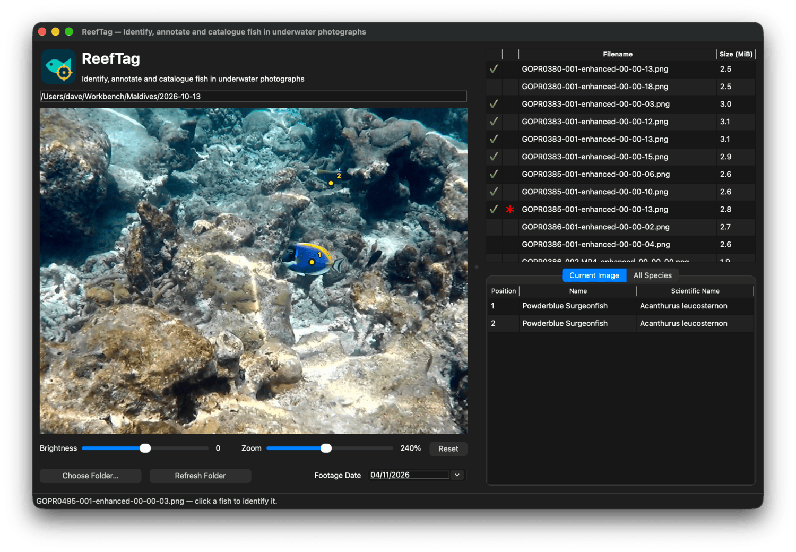

## Overview

**ReefTag** is a Python desktop application for identifying, annotating and cataloguing fish in underwater photographs.

Developed following a visit to the Maldives in October 2026, ReefTag is the latest in a series of small software projects inspired by the underwater photographs and video footage collected during the trip. Where _ReefFrame_ enhances and processes underwater footage, and _FishTrack_ explores the detection and tracking of fish within video sequences, _ReefTag_ addresses a different question:

> What exactly am I looking at, and how can I keep a record of it?

_ReefTag_ provides a simple, interactive workspace for examining still images, identifying individual fish and building a reusable catalogue of the species encountered. It is deliberately a human-operated identification tool, rather than an automated classifier. The user makes the identification, while _ReefTag_ handles the annotation, organisation and persistence of the resulting data.

### Features

- **Browse underwater photographs** — select a folder containing PNG or JPEG images and navigate through its contents
- **Identify fish interactively** — click directly on a fish to create an identification, recording its position in the original image
- **Annotate multiple individuals** — add numbered markers to distinguish individual fish, including multiple examples of the same species within a photograph
- **Maintain a species catalogue** — record common and scientific names and reuse existing species identifications across photographs
- **Review and edit identifications** — revisit previously annotated images, change identifications or remove them when necessary
- **Explore image detail** — adjust preview brightness, zoom up to 400% and pan around enlarged images without modifying the original photographs
- **Track annotation progress** — identify photographs that have already been tagged using visual indicators in the file list
- **Record footage dates** — associate photographs with their original recording dates
- **Preserve work between sessions** — store images, species and identifications in a local SQLite database, and remember the most recently used folder, image and viewing settings

### How It Works

The workflow is straightforward:

1. Select a folder containing underwater photographs
2. Choose an image and examine it, adjusting brightness or zoom as necessary
3. Click on a fish and select an existing species or enter its common and scientific names
4. Repeat for other fish in the image
5. Move on to the next photograph

Each identification is represented by a numbered marker overlaid on the image and a corresponding entry in the "current image" identification list. The underlying photograph remains unchanged, and the identification coordinates are retained relative to the original image.

All observations are stored in a local SQLite database, allowing previously catalogued images and species to be revisited in subsequent sessions.

### Design Philosophy

_ReefTag_ is intended to be a small, practical field-cataloguing tool, rather than a comprehensive marine biology or image-analysis platform.

It does not attempt to recognise species automatically, validate taxonomic names against external databases or replace specialist identification resources. Instead, it supports the process of examining photographs, making identifications and maintaining an organised record of what has been observed.

Like _ReefFrame_ and _FishTrack_, _ReefTag_ began as a solution to a specific problem encountered while working with footage from the Maldives. It is an experiment in making that process a little more useful, enjoyable and repeatable.

## Getting Started

Please see the [Wiki](https://github.com/davewalker5/ReefTag/wiki) for the user guide, controls and further details.

## Authors

- **Dave Walker** - _Initial work_

## Feedback

To report an issue or suggest an improvement, please use the project's [GitHub Issues](https://github.com/davewalker5/ReefTag/issues) page.

## License

This project is licensed under the MIT License — see the [LICENSE](LICENSE) file for details.
